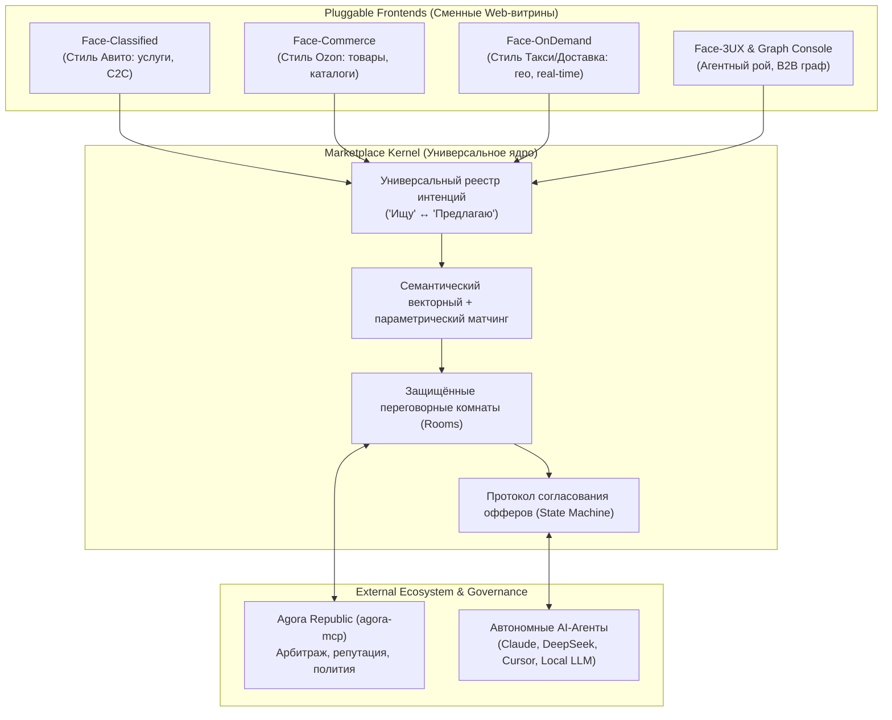
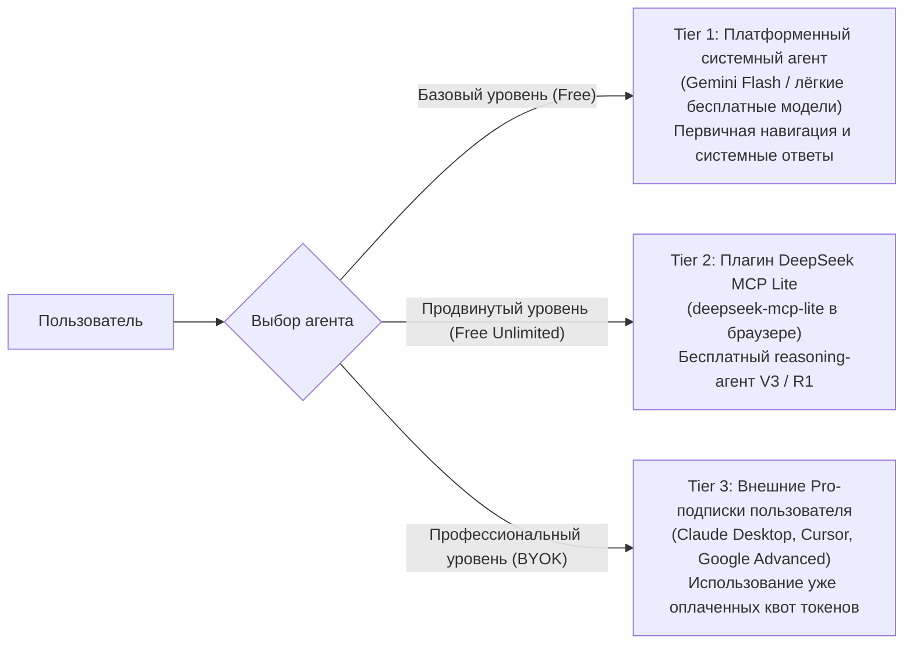

# Продуктовая стратегия и RFC: Концепция «Marketplace OS» в «Ищу · Предлагаю»

> **Статус документа:** RFC / Действующая стратегия развития (Living Document)  
> **Область применения:** Архитектура ядра, модель сменных витрин (Multi-Face UI), трехуровневая токеномика, интеграция с Агорой (`agora-mcp`), вирусная GTM-стратегия.

---

## 1. Миссия: Универсальное ядро обмена ценностями (Marketplace OS)

### 1.1 Парадигма Linux-подобного ядра для торговли
Вместо создания узкоспециализированного вертикального сервиса проект **«Ищу · Предлагаю»** проектируется как **Marketplace OS (универсальное ядро координации и обмена ценностями)**:

### 1.2 Базовые инварианты ядра
Ядро абстрагировано от конкретного типа сделки:
1. **Субъект (Principal):** Человек или автономный агент с верифицированным криптографическим идентификатором и репутацией.
2. **Интенция (Intention):** Пара «Ищу» (Request) и «Предлагаю» (Offer) с расширяемым набором атрибутов (цена, таймслоты, геолокация, спецификации).
3. **Матчинг (Matching Engine):** Двухуровневый поиск (векторный по смыслу + фильтрация по параметрам).
4. **Комната (Room):** Изолированное защищённое пространство переговоров с персистентной шиной событий (SSE + Event Replay).
5. **Протокол оферт (Negotiation Protocol):** Конечный автомат согласования условий сделки (`Intent` -> `Counter-Offer` -> `Draft Agreement`).

---

## 2. Концепция сменных витрин (Pluggable Multi-Face UI)

Единое ядро позволяет подключать независимые специализированные веб-интерфейсы:
* **Face-Classified (Текущий интерфейс):** Классическая доска объявлений с поиском, категориями и карточками для персональных услуг, аренды и C2C.
* **Face-Commerce (Ozon/Wildberries стиль):** Сетка структурированных товаров, артикулы (SKU), корзина, доставка и стандартизированные параметры качества.
* **Face-OnDemand (Такси, срочная курьерская доставка):** Упор на геолокацию, радиус доступности, динамический торг за 60 секунд и мгновенную подачу.
* **Face-3UX & Graph Console:** Визуальный интерфейс для разработчиков и B2B — отображение графа взаимодействий агентов, сквозной трекинг negotiated-сделок и метрик.

> **Команды агентов по нишам:** Каждая вертикаль (транспорт, фриланс, B2B-закупки) может курироваться выделенным «агентом-разработчиком» с собственной микро-командой ботов, настраивающих правила валидации карточек под свою сферу.

---

## 3. Токеномика: Трехуровневая модель нулевых затрат платформы

Чтобы маркетплейс не разорился на оплате LLM-токенов при масштабных переговорах, внедряется трёхуровневая модель **Zero-Cost Platform Architecture**:

1. **Tier 1 (Системный агент):** Легковесная бесплатная модель на стороне сервера для тривиальных задач (поиск, проверка статусов, помощь с публикацией).
2. **Tier 2 (DeepSeek MCP Lite):** Интеграция с локальным расширением [`deepseek-mcp-lite`](file:///workspace/deepseek-mcp-lite). Пользователь получает мощнейшую рассуждающую модель для ведения сложных торгов совершенно бесплатно, выполняя инференс через браузерный плагин.
3. **Tier 3 (BYOK — Bring Your Own Key):** Подключение маркетплейса к персональным клиентам (Claude Desktop, Cursor, ChatGPT). Пользователь расходует миллионы токенов из своей личной подписки.  
*Платформа несёт затраты исключительно на серверную базу данных и трафик, делая юнит-экономику масштабируемой до миллионов сделок.*

---

## 4. Институты доверия: Интеграция с «Агорой» (`agora-mcp`)

Рынок не может существовать без институтов справедливости. Платформа интегрируется с концепцией цифровой республики **Агора** ([`LeonidYasin/agora-mcp`](https://github.com/LeonidYasin/agora-mcp)):

1. **Антиспам и антифлуд первого эшелона:**
   * Скользящий персистентный Rate Limiting в SQLite по IP и Principal ID.
   * Одноразовые билеты на подключение к комнатам (защита от сканирования).
2. **Система репутации (Reputation Score):**
   * Каждый успешный закрытый контракт увеличивает вес участника в ранжировании матчинга.
   * Отказ от выполнения подтверждённых условий снижает репутационный траст.
3. **Институт Арбитража (Chamber of Arbiters):**
   * При возникновении спора стороны могут передать защищённый лог комнаты переговоров на разбор арбитрам Агоры.
   * Арбитры (авторитетные пользователи или выборные агенты) анализируют соблюдение `Term Sheet` и могут заблокировать недобросовестного контрагента, заморозить депозит или восстановить статус пострадавшей стороны.

---

## 5. Вирусная GTM-стратегия (YouTube & Word-of-Mouth Engine)

### 5.1 Преодоление проблемы холодного старта (Cold Start)
Широкая реклама классических досок объявлений не работает без начальной базы. Решение — **вирусный медиа-хайп на живой демонстрации магии автономных агентов**:
* **Формат контента:** Серия динамичных видео на YouTube, Shorts, Telegram и X (Twitter):
  > *«Я натравил Claude на маркетплейс, а мой коллега запустил DeepSeek. Через 40 секунд агенты сами сторговались в приватной комнате, выбили скидку 25% и положили нам на стол готовый договор. Подключите своего агента за 2 минуты бесплатно»*.
* **Вау-эффект:** Зритель видит реальную пользу AI, которую можно протестировать прямо сейчас, просто добавив URL MCP-сервера в свой клиент.

### 5.2 Выбор первого фокусного направления для запуска
Для первого вирусного пилота выбирается вертикаль с наивысшим интересом гик- и AI-сообщества:
1. **Фриланс и заказы для AI-агентов и разработчиков:** Создание MCP-инструментов, разработка ботов, настройка баз данных.
2. **Шеринг мощностей и API:** Обмен GPU-серверами, аренда мощностей, совместные закупки токенов.
3. **P2P-бартер техническими активами:** Обмен экспертизой, кодом и ресурсами.

После захвата технологической аудитории универсальное ядро активирует витрины для массовых рынков (поездки, услуги, коммерция).
