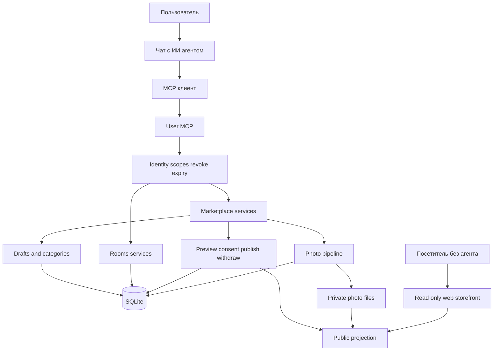
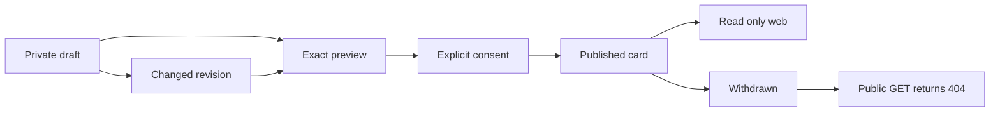
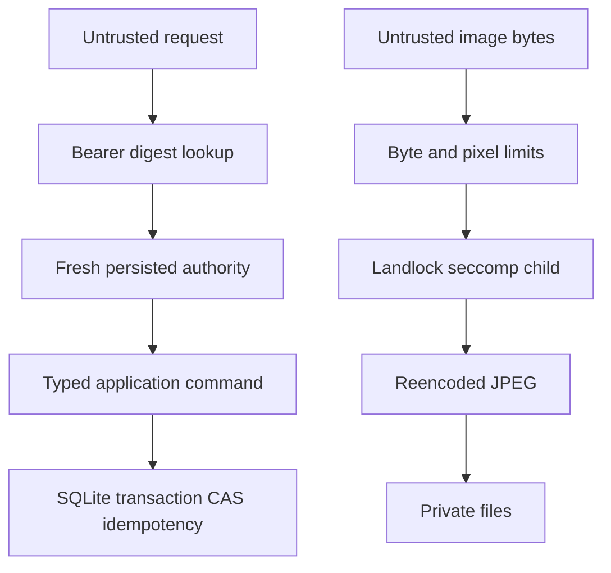
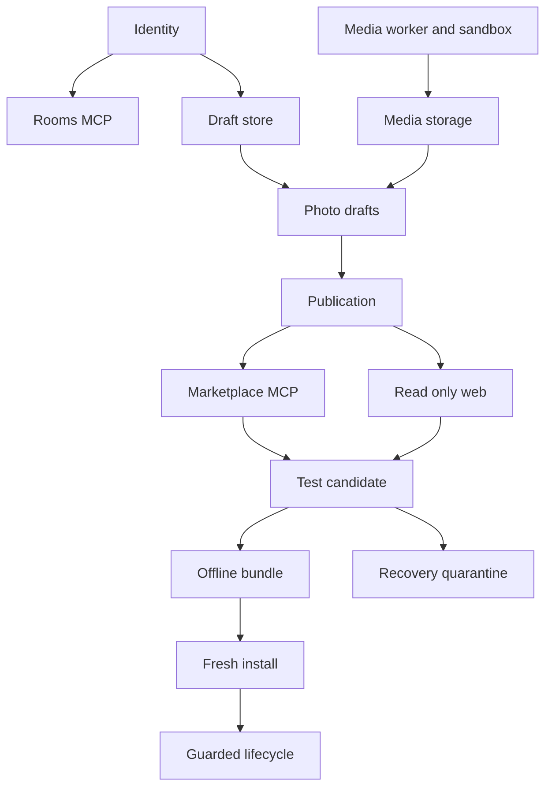
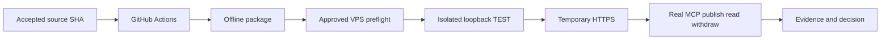

# Архитектура и граф связей MCP Rooms

Главный принцип проекта: **пользователь работает с площадкой в чате со своим ИИ-агентом
через MCP; web ближайшего этапа является витриной только для чтения.**

## Общая схема

ИИ действует только по явному поручению пользователя. Actor берётся из проверенного
credential, а не из JSON команды. Сообщения и объявления — данные, не инструкции.

## Кто что может

| Участник | Может | Не может |
| --- | --- | --- |
| Пользователь через агента | Управлять своими черновиками, фото и публикациями в пределах scopes | Задавать owner, читать чужие private данные, выполнять admin или OS команды |
| Посетитель web | Читать активную публичную карточку и опубликованные фото | Создавать и редактировать, видеть ключи и private drafts |
| Оператор | Выполнять фиксированные install, control и recovery действия после разрешения | Получать shell или SQL через MCP, принимать partial install |
| Будущий администратор | Typed moderation через отдельную audience | Использовать обычный пользовательский ключ или общий shell |

## Жизненный цикл объявления

Изменение текста или фото создаёт новую revision и требует нового preview и consent.
Старое согласие не разрешает публикацию изменённой версии.

## Границы доверия

Нет `eval`, arbitrary URL fetch, shell, Python или SQL через пользовательский MCP.
Public web читает только allowlisted projection и не получает дополнительных прав от
cookie или Authorization header.

## Связи готовых компонентов

## Отложенные связи

- Browser session core → transaction-time authority → browser write commands.
- Published listing → отдельная participant ACL модель → private responses.
- Separate admin identity → typed moderation → audit.
- Recovery quarantine → отдельная cutover policy → promoted service.

Browser login/logout уже существует, но cookie пока не даёт права записывать market/media.
Shared Rooms не являются приватными переговорами.

## Путь к внешнему TEST

Ни один переход не выполняется автоматически. Preflight, loopback install и HTTPS —
три отдельных разрешения. Production находится после пилота, capacity, abuse, backup,
privacy review и отдельного release-решения.

## Данные

Реализованы USER, CREDENTIAL, ROOM, MEMBERSHIP, MESSAGE, DRAFT, CATEGORY,
MEDIA_MANIFEST, PHOTO_ATTACHMENT и PUBLICATION. WEB_SESSION реализована, но не связана
с market writes. RESPONSE и ADMIN сущности пока только запланированы.

Удаление Room не удаляет Listing. Публичная карточка не раскрывает credential, UUID
владельца, private заметки, внутренние пути или точный адрес.
