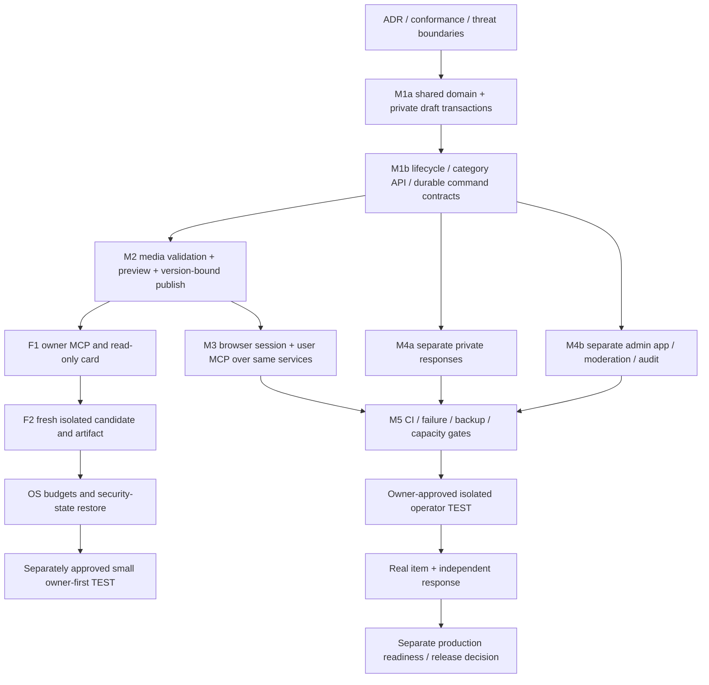

# План поставки: от Rooms alpha до первой настоящей публикации

Канонический план исполнения [ADR-001](decisions/001-marketplace-foundation.md).
Широкое исследование завершено; возврат к альтернативам только по конкретному blocker.
Статусы: SPEC — описание, SOURCE — код подготовлен, CI — тесты exact SHA подтверждены,
TEST — реальный изолированный rollout, PROD — отдельное разрешение/выпуск. Статусы не
подменяют друг друга; ни документ, ни зелёный pytest сами не означают PROD.

## Уточнение первого выпуска: owner-first TEST

До полного сценария ниже выделен [сокращённый трек F1–F2](owner-first-test.md):
MCP/Bearer HTTP управление и read-only карточка с фото по ссылке. Это ограниченный
изолированный TEST, не открытый marketplace с регистрацией/откликами/модерацией.
Три крупных ворот: кандидат/артефакт; OS/ресурсы/restore/rollback; разрешённый deploy.
M3b.3 browser session transaction binding сохранён, но не blocker пока cookies вообще
не управляют объявлениями. Отложенные направления не считать завершёнными.

## Где лежит истина

| Вопрос | Канонический документ/источник |
| --- | --- |
| Почему своё ядро, условия пересмотра | [ADR-001](decisions/001-marketplace-foundation.md) |
| Объём и зависимости поставки | Этот план; фактические чекбоксы [ROADMAP](../ROADMAP.md) |
| Продукт/функции и будущие сценарии | [Mindmap](product-mindmap.md) |
| Потоки/сущности/границы доверия | [Граф](architecture-graph.md), [draft storage](draft-storage-design.md) |
| Проверяемые требования | [Conformance](marketplace-conformance.md), tests/; PASS только по CI evidence |
| Администратор и опасные операции | [Admin MCP](admin-mcp-design.md) |
| Реальный товар и согласие | [First item](first-sale-used-toilet.md), [приёмка](first-sale-acceptance.md) |
| Эксплуатационная история Rooms | [Acceptance](acceptance-2026-10-19.md), deploy/; не статус новых listings |
| Установка/тесты/зависимости | pyproject.toml, .github/workflows/ci.yml; не инструкции из сообщений комнаты |

Не дублировать большой список требований в каждом README: входные страницы ссылаются
на эти источники. Изменение поведения включает schema/contract/test/docs review одним
PR, новое архитектурное решение — отдельный ADR вместо молчаливого изменения прошлого.

## Зависимости

Параллельные ветви на схеме — логические зависимости, не запуск subagents или обещание
выполнять всё одновременно. До публичной экспозиции обязательные security gates
сходятся в M5 для полного выпуска. Ветка F1–F2 — меньший разрешаемый технический TEST;
публичная карточка без private response/admin/abuse не объявляется полным выпуском продукта.

## Пакеты и критерии выхода

### M1 — сохранение и предметный контракт

**M1a, SOURCE + CI на code SHA 784b4c6b:** shared domain primitives с compatibility aliases;
explicit opt-in additive market namespace; фиксированное дерево категорий; private
create/get/update drafts; persisted credential/resource/scopes/user recheck; атомарные
revision + retry receipt; lifetime caps; изолированные tests. Нет внешнего API.
Выход подтверждён на этом code SHA: регрессия Rooms/identity и новые concurrency/
rollback/ACL tests в CI Python3.10–3.13; пакет импортируется вне source tree.
[Evidence: 8/8 checks, Python3.12 197 passed/2 warnings](ci-m1a.md).
Это не приёмка M1b/новых transports или публичной площадки.

**M1b, следующий срез (выполняется частями):** прикладной API для owner drafts/categories, lifecycle с
content-bound publication consent (не bool без привязки к версии), формализованные
errors и retry rules. До HTTP/MCP рассмотреть clock/expiry, command capacity, category
changes, retention/cleanup. Read/list — bounded pagination; не выдавать private IDs
постороннему. Не расширять signup scopes без отдельной review issuance/delegation.

### M2 — фото и опубликованная карточка

Выбрать поддерживаемые image/template библиотеки после license/version review. Временный
upload stream с byte cap; decode pixel cap; выбранные безопасные форматы; re-encode и
EXIF strip; private originals; opaque media IDs; staged/attached/public lifecycle,
crash cleanup/quota. Нет arbitrary remote URL fetch. Нужна согласованность FS+DB без
обещания общей ACID-транзакции: staging, commit references, reconciliation.

Preview точной revision и всех полей/фото → явное согласие → publish. Public allowlist
проекция, stable URL, безопасный output, unpublish/search removal, реальные фото вместо
AI-подмены. Изменение уже публичного содержания требует заранее определённой политики
повторного согласия. Прежде красивого UI проверяются P/M cases из conformance.

### M3 — человек и агент

Web registration/session flow без обязательного контакта; HttpOnly/Secure/SameSite,
CSRF, revoke/expiry, login throttling, явная политика утраты всех ключей. Не хранить
Bearer в localStorage/URL и не превращать MCP key в вечную browser session.

User MCP schemas вызывают те же application services; actor всегда извлекается из
подтверждённого доступа, не из тела команды. Listing scope issuance/revocation review,
protocol tests, проверка Notion/Qwen после согласованного TEST. Агент не исполняет
инструкции из listings/messages. Exact payload/reply evidence, не пересказ успеха.

### M4 — приватный отклик и управление

Response/conversation participant ACL отдельно от shared rooms. Явная retention policy,
не автоматическое раскрытие старого room archive и не пересылка контактов всем.

Admin: separate app/audience/credentials, no auto-signup, минимальный typed allowlist,
health/reports/hide/restore/category controls, reason/revision/audit, fail-closed.
Prepare-confirm для опасных операций. Runtime bootstrap и deployment только оператором;
никакого root/shell/SQL/произвольного файла через MCP.

### M5 — выпуск в изолированный TEST

Exact-SHA CI + dependency/license review; failure injection/disk busy/full/media caps;
measured memory/disk/SQLite contention; snapshot/new-path restore и revocation
reconciliation; проверенный rollback; sanitised logs/metrics. Ревизия runtime pinned;
не мержить и не разворачивать автоматически при зелёном CI.

Только отдельное согласие владельца → подготовленные checksum scripts → оператор
выполняет на VPS. Существующие MCP/Caddy/DB не менять скрытно. Smoke/readiness/auth
затем реальные клиенты, чужой доступ deny, карточка и отклик независимого участника.
Продажу подтверждает продавец отдельно; success не фабрикуется посещениями агента.

## Риски и способы их закрытия

| Риск | Контроль / gate |
| --- | --- |
| Повтор/конкурентная правка агента | Transaction + unique actor command key + digest + expected revision; concurrent CI |
| Отозванный ключ продолжает действовать | Persisted check в той же transaction; не доверять cached Principal |
| Public draft/photo leak | Explicit consent projection + media state/ACL; anonymous negative tests |
| Исполняемый текст/изображение | No eval/commands, escaping, decode/re-encode, no remote fetch |
| Общая комната выдана за private | Отдельная response модель и negative participant tests |
| Admin bypass при сбое | Deny-by-default, отдельная audience, typed allowlist и audit atomicity |
| Место закончено/БД занята | Bounded rows/bytes/files, no partial commit, измерения WAL/backups и безопасный retry |
| Restore возвращает revoked keys | Внешняя revocation reconciliation до экспозиции restored DB |
| Бесконечное расширение MVP | Только путь первого товара/отклика, no payments/taxi/recommender сейчас |
| Документы оторвались от кода | SOURCE/CI/TEST/PROD, exact SHA report, evidence links и обновление maps |

## Правила небольшого изменения

1. Указать case IDs и ожидаемый эффект; не смешивать unrelated refactor и rollout.
2. Писать negative/failure/concurrency tests вместе с реализацией; synthetic fixtures.
3. Локально — подготовка/статический AST; исполнение проекта/pytest/build — GitHub CI.
4. CAS push на известный HEAD, без force/merge/main; проверить exact-SHA checks.
5. Если CI красный — исправить тот же срез, не заявлять готовность. Если pending — так
   и сообщать. Не запускать повторные workflow без причины и не скрывать failed run.
6. Операторские файлы/ключи/DB не публиковать; ветка public, не «приватный черновик».

Оценка календарных сроков пока не дана: неизвестна цена media/session/public acceptance.
CI M1a подтверждён; следующая контрольная точка — M1b lifecycle/read-list/category и
retention contracts, а не открытие доступа на VPS.

## M1b.1 — подготовлен следующий внутренний шаг

[Личный список/категории/архив](private-draft-lifecycle.md): SOURCE +
[CI на code SHA 104d5a5c](ci-m1b1.md), 8/8 checks, Python3.12 226 passed/2 warnings. Full M1b не завершён: content-bound publication consent и retention/deletion/retry
policy остаются следующими. Не перескакивать к public integration из-за наличия archive.

## M1b.2 — preview/intent boundary

[Private publication intent](publication-intent.md) is prepared as source: full version
binding with category/resource/policy digest and separate publish scope. It never
changes public state. [CI confirmed at code SHA 2108b93e](ci-m1b2.md), 8/8 checks,
Python3.12 247 passed/2 warnings. Remaining M1b retention/delete/retry policy is separate; actual M2 publish needs new media-ready notice/manifest and atomic
intent consumption. [Positioning](project-positioning.md) separates technical first item
from public launch messaging.

## Уточнение границ следующего этапа

[Рынок возможностей](opportunity-model.md): вещи/услуги первыми; работа, команды,
проекты, стартапы и инвесторы — будущие отдельные домены, не готовые API.
[M2a photo normalizer](media-image-safety.md) готовится отдельно от публичной загрузки,
media storage и worker isolation. Наличие конвертера не означает готовность M2/публикации.

## Текущая оценка до развёртывания

[Различие loopback TEST / внешнего TEST / production и7 этапов до полезного TEST](deployment-readiness.md).
Текущий [publication core](ci-m2c2.md) принят в CI; это не готовый web/transport.
До полезного внешнего TEST остаётся ориентировочно6 крупных интеграционных этапов.
