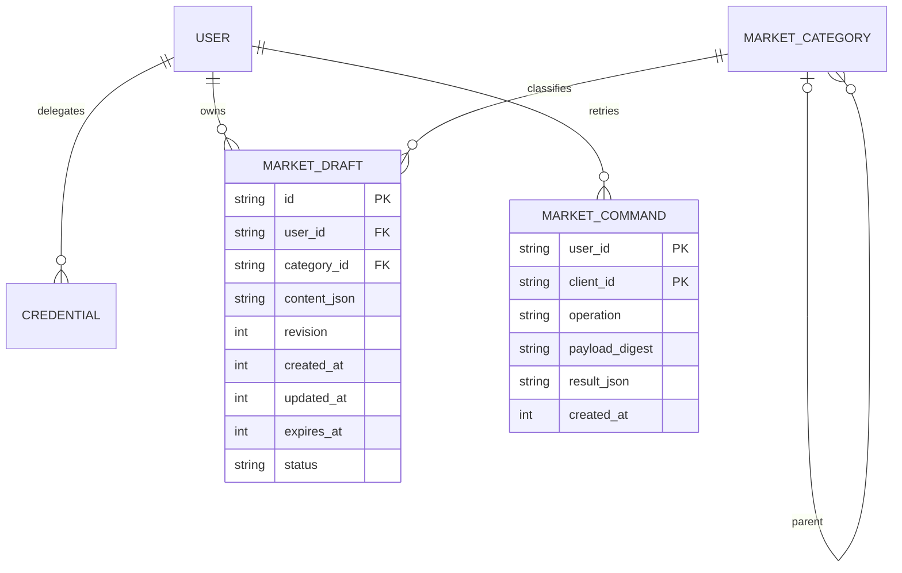
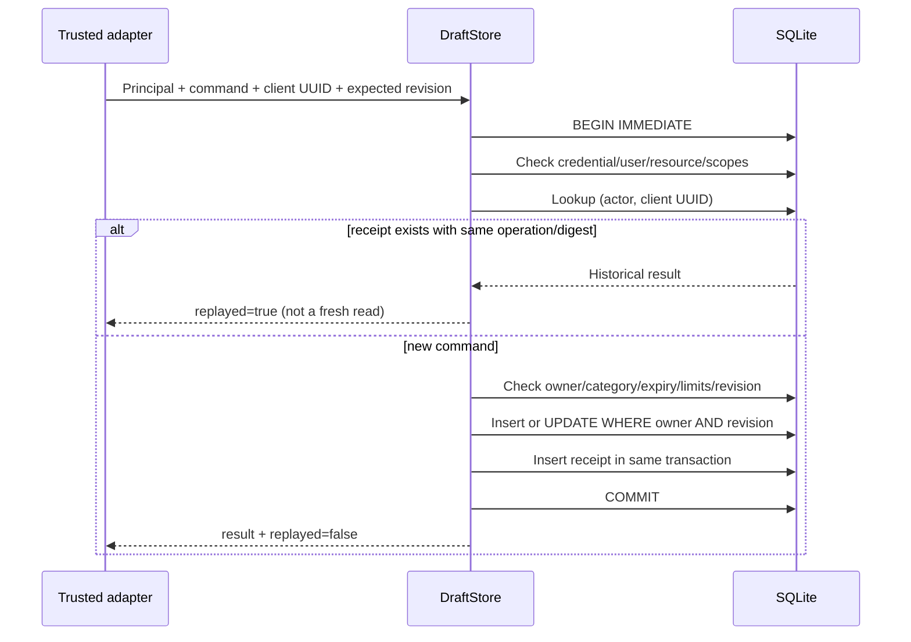

# Private draft storage — M1a + M1b.1, не публичный marketplace

Код: `domain.py`, `listing_contract.py`, `draft_store.py`.
Статус базового M1a: [CI подтверждён на code SHA 784b4c6b](ci-m1a.md).
Расширение M1b.1: [lifecycle/schema v2](private-draft-lifecycle.md),
[CI подтверждён на code SHA 104d5a5c](ci-m1b1.md);
HTTP/MCP/enrollment integration отсутствует.
[План](delivery-plan.md) / [conformance](marketplace-conformance.md).

## Инварианты

- Существующий standalone application_id и PRAGMA user_version=2 не меняются.
- `DraftStore.initialize()` вызывается явно только на уже открытом RoomStore, не из
  create_app. Additive namespace `market_schema(version=2), explicit v1→v2 migration`; partial/future namespace
  не перезаписывается. Данные существующих комнат не мигрируются в объявления.
- Ошибка миграции откатывает DDL транзакцию. Повтор initialize не сбрасывает taxonomy.
- Обычная IdentityStore/enrollment по-прежнему выдаёт только rooms scopes. Listing
  scopes в новых тестах — прямые synthetic temporary DB fixtures, **не рабочая выдача**.
- Internal DraftStore получает trusted Principal от будущего authenticating adapter.
  Сам raw secret не проверяет; знание credential ID не аутентификация. На каждой
  транзакции дополнительно сверяет user/credential, resource, persisted scopes,
  expiry/revoked/disabled. Все публичные адаптеры обязаны сначала проверить секрет.
- Пока private draft/archived и own list, без publish/delete/публичного search. Media IDs
  отклоняются до реализации media ownership/validation. Нет file/image/network ops.

## Сущности

Контент использует имеющийся ListingContent (root category); `category_id` — конкретная
рубрика. Seed: things → home-repair → plumbing → toilets и services. Это маленькая
начальная taxonomy, не полноценный admin CRUD. Проверяется root match/active ancestry,
максимум 8 уровней, цикл/недоступный родитель → deny. ID категории не ID пользователя.

## Запись и повтор

`client_id` — UUID, общий namespace операций одного actor. Другой payload/operation
с тем же ключом → `idempotency_conflict`. Нормализованный payload сериализуется stable
JSON и digest SHA256; includes category/content/target/expected_revision. Результат
повтора — исходный snapshot (он может быть устаревшим), а не подтверждение текущего
содержимого, публикации или существования объекта. Новое чтение — отдельный `get`.
Expiry/revocation ключа проверяется даже при replay. Новый ключ того же actor может
повторить команду; чужой actor не читает receipt. Секрет ключа/credential ID не пишутся
в receipt; content там private, только в private DB и будущих защищённых backup.

`BEGIN IMMEDIATE` serializes writers; SQL UPDATE дополнительно включает owner/revision.
Receipt failure → rollback всего изменения. Новый request со старой revision → conflict,
повтор исходного успешного request → исходный ответ. Нельзя удалять receipts по TTL без
контракта reuse ключа; сейчас автоматического удаления нет, lifetime limits fail closed.

## Лимиты и эксплуатационные границы

Defaults: 500 drafts total, 25/actor, 2000 command receipts total, 100/actor. Даже
expired drafts/receipts учитываются до отдельной проверенной cleanup policy. Отдельный
receipt на каждое обновление — сохранение privacy/retry history, не полноценный audit.
Общий RoomStore page cap 64 MiB сохраняется; эти row caps не гарантируют запас диска
при всех Unicode payload/старых room данных. WAL/media/backups требуют отдельного
filesystem budget. Ни lifetime caps, ни SQLite cap не являются публичной anti-bot системой.

Draft expiry — прежний domain default 30 days. Истечение draft не равно физическому
удалению private content. Retention/owner delete/cleanup необходимы до широкого доступа.
Новые read/write adapter errors должны быть bounded/sanitized; текущий внутренний слой
может бросить sqlite exception, его нельзя показывать клиенту напрямую.

## Совместимость и тестирование

`store.RoomError`, `_id`, `_text`, `identity.Principal` остаются aliases/re-exports общих
примитивов. Domain listing больше не импортирует private helpers RoomStore. Это
целевой extraction без изменения wire errors/default room scopes/schema version.

`tests/test_draft_store.py`: persistent reopen, schema idempotency/future/partial fail,
owner privacy, scope mismatch, revoked/disabled/expired/resource check, same-user rotation,
CAS concurrency, duplicate concurrency, changed payload conflict, receipt rollback,
quotas, media refusal, category parent disable, expiry/clock rollback, room compatibility.
Это storage/application tests, не доказательство public media/session/admin/production.

Дополнение: [private list/category/archive и migration sequence](private-draft-lifecycle.md).
Результаты базового M1a не заменяют отдельные CI evidence новой версии.
