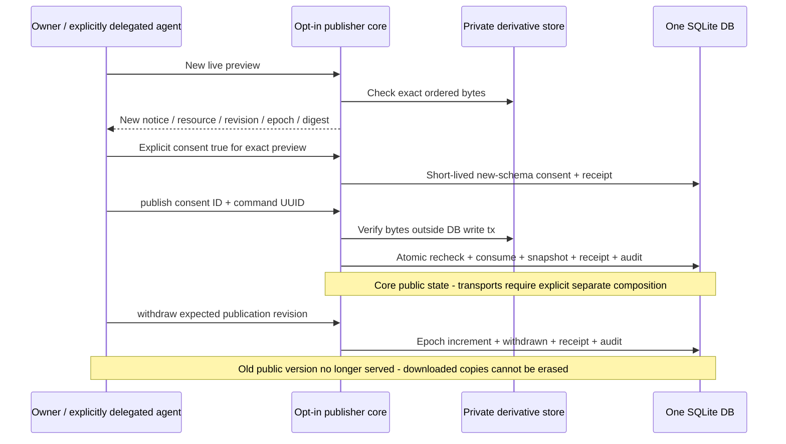

# M2c.2 — транзакционное ядро публикации и снятия

Внутренний opt-in `PublicationStore`, не запущенный публичный web/API. Отдельный
[user MCP adapter](user-market-mcp.md) проверен в CI как явная composition API;
Это исходный контракт ядра M2c.2. Позже приняты opt-in user MCP, private photo HTTP,
browser session bridge и [F1 read-only карточка](ci-f1.md); default CLI и VPS
этим не включаются. Auto market onboarding, каталог/search и приватные отклики
по-прежнему отсутствуют.
Никакая настоящая вещь не опубликована этим кодовым срезом.

## Новое согласие, не повышение старого intent

Текущий notice-контракт `mcp-rooms/live-publication-consent/v3` (по compare c v2:
+allowlisted `card.author`) отличается от обоих private intents и прежнего
+live-consent/v1/v2. Старые v1/v2 согласия не разрешают новую публикацию v3.
SQLite publication namespace остаётся версии1, не мигрируется
на request. Поле preview `public_transport_enabled: null` означает, что core не знает
настройки opt-in transport.
Preview включает точный private record, отдельный allowlisted card_preview (время
будущей публикации ещё не назначено), публичные поля/порядок и проверенные
фото, путь категории, resource, notice и текущую publication epoch. Notice объясняет:
будущая публичная карточка доступна всем, текст/география/фото видны, личные данные
введённые в эти поля тоже станут публичными; снятие не уничтожает чужие копии.
Приватные комнаты, ключи и свойства аккаунта в проекцию не входят.
Публичная проекция включает `card.author` — display-name автора (без user UUID,
credential и контактов); комнаты не раскрываются, объявление остаётся независимым
от комнаты сущностью.

`confirm(..., consent=True)` требует отдельного listings:publish, exact revision/digest
и свежих persisted grants. Это короткое согласие, не публикация и не доказательство
человеческого просмотра. Делегированному агенту перед настоящей публикацией всё равно
нужно явное решение владельца по показанным материалам. Старые v1/v2 private intents
не копируются, не повышаются и не принимаются publisher-ом.

`publish` заново проверяет владельца, права, категорию, срок, version/epoch,
ordered manifest и bytes. Затем **в одной SQLite write transaction** повторяет
проверки, одноразово потребляет согласие, сохраняет публичный снимок, command receipt
и audit с intent ID и preview digest (без secret). При ошибке любого шага не должно оставаться частичной публикации/consumption.
Checksum I/O проходит под shared root guard, но вне SQLite write transaction.
Срок согласия <=5 минут и не позже draft/media expiry; подтверждение не продлевает
жизнь объявления. No public endpoint is enabled by this internal transaction.

## Снимок и правила редактирования

Private draft остаётся private; public state хранится в отдельной additive namespace
с FK в той же БД. Это один источник данных, не второй writable каталог. Публичная
карточка — immutable allowlisted snapshot, а не прямое чтение private JSON.

В первой ограниченной версии **нужно снять активное объявление перед редактированием**.
Legacy text update/archive, photo-aware edits и новый staging проверяют это в своей
транзакции. Read/list private draft и исторические replay не публикуют ничего нового.
Так удаление/перестановка фото не оставляет публичную карточку с коротким staging TTL
или незаметно изменёнными материалами. После снятия можно редактировать и получить
новые preview/consent; прямого public patch пока нет.

`publication_revision` — отдельная монотонная epoch: publish1 → withdraw2 → publish3.
Изменение эпохи делает все прежние неподтреблённые согласия непригодными, даже если
текст ещё не менялся. Public card также показывает private source revision.
Конкурирующие publish не могут потребить одно согласие дважды.

Повтор command UUID возвращает **исторический receipt**, не текущий статус:
повтор publish после withdraw не публикует снова; повтор withdraw после новой
публикации не снимает её. Интерфейс обязан перечитать актуальный статус, а не
показывать успех только по историческому `state` из replay. Иной payload конфликтует.

## Публичная проекция и фотографии

Internal `public_get(id)` возвращает только разрешённые поля объявления, category
path, проверенные metadata фото и publication version/time/expiry. Нет owner/user UUID,
credentials, source hashes, filesystem keys/paths, private receipts или комнат.
Это **JSON data, не HTML**: будущий renderer обязан использовать autoescape.
Не обещаем автоматическое удаление телефона, если сам автор вписал его в description.

`public_photo(listing_id, publication_revision, media_id)` принимает только opaque IDs,
не filesystem path. Проверяются активность снимка, неотключённый владелец, категория,
expiry, точное соответствие draft/links/manifest и digest bytes; после file I/O идёт
повторный DB check. Старая версия URL после снятия/перепубликации не обслуживается.
Private/missing/withdrawn/disabled/expired/corrupt результаты не различаются для reader.

[F1 read-only adapter](owner-first-test.md) выдаёт `Cache-Control: no-store`, фиксированный JPEG
content type, nosniff, bounded ответы и per-process admission/budget. Это opt-in код,
не работающий внешний endpoint, не CDN invalidation и не возможность отозвать уже
скачанные данные. Audience/allowlist
полей не заменяют abuse controls или правила запрещённых товаров.

Public expiry не позже fixed draft expiry. Attached photos уже удерживаются до него;
существующая cleanup-grace срабатывает после окончания публичной доступности.
Нет новых публичных pin-файлов или обхода retention. Withdraw может выполниться без
работающей категории/фотографий и даже после expiry; он не удаляет историю/файлы.
Отзыв одного credential не снимает объявления пользователя; disable user скрывает их.
Административные hide/disable ещё не являются доступными admin MCP методами.

## Additive schema и ограничения

`PublicationStore.initialize()` — отдельная явная транзакция: publication_schema1,
listing_publications, publication_consents, publication_audit. Нужны market2/media3;
RoomStore identifiers не изменяются. Partial/future namespace отвергается; request
handlers ничего не мигрируют. Схема не применялась к реальной VPS БД.

Количество публикаций ограничено draft cap; consent/audit связаны с существующим
конечным command budget (global2000/owner100 по умолчанию). Это bounded pilot, не
политика бесконечной истории. Ротация audit/receipts, полное восстановление DB+files,
OS isolation, реальные нагрузки/abuse и отдельный admin auth остаются gates.

## Поток

См. [план деплоя](deployment-readiness.md), [частные фото](photo-drafts.md),
[admin boundary](admin-mcp-design.md). [Exact-SHA CI evidence](ci-m2c2.md) фиксирует принятую версию; документация
сама по себе не является приёмкой работающего web.
