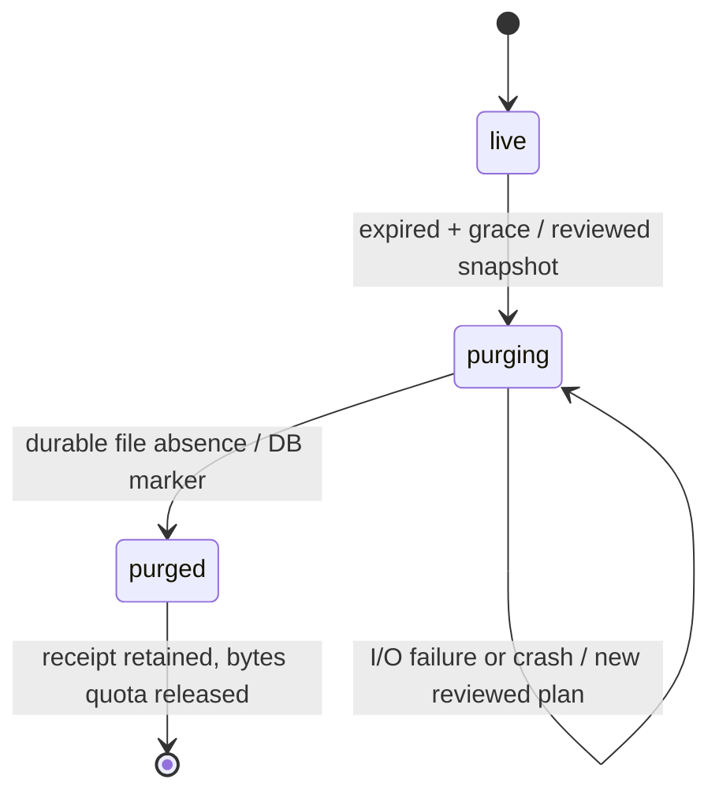

# M2b.4 — reviewable media retention and quota reclamation

Internal **operator-only** code, not a user capability, admin MCP, HTTP endpoint,
CLI command or scheduled task. No operator has applied it on the VPS. Exact-SHA
[Exact-SHA CI acceptance](ci-m2b4.md) covers this internal retention slice. A plan digest is not authentication.

## Dry run before destructive work

`MediaCleanup.plan()` only reads the explicitly injected staging database and
private root. It returns a bounded report: opaque media IDs, counts, blocker codes,
missing IDs and a snapshot digest. No blob keys, paths, original bytes or credentials
are returned. Access to this report itself must remain operator-controlled.

The snapshot binds full media rows, root/database inode identity, file identity,
mode/uid/link-count/size/timestamps and checked byte digests. At most512 receipts,
256 files and32MiB logical inventory are scanned. Photo decoding is not performed.
Unknown files, symlinks/hardlinks/shared files, duplicate/invalid manifest keys,
corruption, missing active derivatives or a reappeared purged file block apply.

**Unreferenced orphan files are reported, never automatically deleted or adopted.**
This intentionally stops budget reclamation if a crash left bytes with no proven
association. An operator must review/recover them through a future explicit flow;
there is no arbitrary-path delete escape hatch or silent orphan grace-period sweep.

`apply(plan)` is a separate explicit operator action. It rebuilds the snapshot,
checks the digest/report and refuses a changed, blocked, future or older-than-five-
minutes plan before deletion. It then rechecks rows in a short write transaction:
new reservations made during checksumming also invalidate the reviewed snapshot.
A plan is bound to that exact store snapshot, not an authorization credential.

## Eligibility and two-phase cleanup

Only an expired private staging record after an additional60-second grace is a
candidate. This applies to STAGED, FAILED and abandoned RESERVED rows. Active data
is not deleted simply because the owner is disabled, a draft changed or storage is
full. Invalid/rewound cleanup timestamps block rather than guess chronology.

A parallel cleanup phase (`live`, `purging`, `purged`) preserves the original upload
state/receipt. This avoids pretending a failed upload later succeeded. Explicit
schema migration1→2 introduced cleanup columns; the current explicit1/2→3
migration also preserves/adds photo links atomically. Room
schema identifiers are unchanged. Reads/staging refuse legacy schemas until explicit
initialization. Partial/future schemas are not repaired automatically.

1. Under the root guard, recheck the reviewed snapshot; briefly mark candidates
   PURGING in SQLite. From that point user reads/replays cannot serve their bytes.
2. Outside a SQLite write transaction, unlink only the proven manifest key relative
   to the pinned private root; no symlink traversal or caller-selected path.
3. Fsync the root directory even if the file is already absent on a resumed pass.
4. In a short SQLite transaction mark that record PURGED; only now exclude its
   reserved byte/count budget from new admission.

A batch is **not** all-or-nothing across SQLite/files. I/O failure can leave some
PURGED rows and others PURGING. Budget remains reserved for unfinished rows.
Obtain a new dry-run plan to resume. An old plan is not blindly replayed. Missing
expired derivatives may be retired after durable absence; missing active ones block.
This is cleanup-resume proof, not complete DB+files disaster-recovery acceptance.

## Race prevention

Cooperating writers and cleanup take the same root guard. Lock order is ROOT then
short DB transactions; no SQLite write lock is held during decode/checksum/unlink/
fsync. Decoding happens outside both locks. Before writing bytes, staging rechecks
credential/draft/TTL and that its reservation is still live under the root guard;
it holds that guard through the final manifest commit or known-failure recording.

If cleanup retires an expired reservation while the decoder is still running, the
late decoder is not implicitly cancelled, but it cannot write a derivative after
reclamation. Failure after bytes but before manifest commit is recorded with its
known file key before releasing the guard. A process/power crash can still leave
an orphan, in which case the next report blocks destructive work.

## Idempotency and bounded receipts

PURGED rows remain tombstones with owner/client UUID/request digest. Cleanup never
deletes command receipts, resets old UUIDs or turns old expired commands into new
uploads. New UUIDs may use reclaimed byte/active-row budget. Tombstones are separately
bounded at512 lifetime receipts globally /128 per owner; hitting that cap remains a
fail-closed admission error. Safe receipt horizon/compaction is not implemented.

No automatic timer or hidden cleanup on ordinary user requests. Root/file locks
have no hard wait deadline; these are bounded candidate policies, not VPS throughput
or hard security-expiry claims. Linux local filesystem/flock/fsync semantics and
same-UID trusted cooperating processes remain requirements. No OS sandbox claim.

## Remaining gates

- Explicit orphan recovery/quarantine decisions, offline DB+files restore proof and
  revocation reconciliation; no automatic deletion of uncertain bytes.
- Dedicated admin authentication/audience/scopes/audit before exposing maintenance.
- Receipt horizon/compaction policy, operator scheduling, load/resource tests and
  actual OS sandbox acceptance.
- Versioned photo attachment, ordered manifest preview/new consent, authenticated
  bounded upload, public web/user MCP interfaces and publication.

See [staging](media-staging.md), [private file layer](media-private-files.md) and
[overall storage design](media-storage-design.md). No VPS, main or live data changed.
