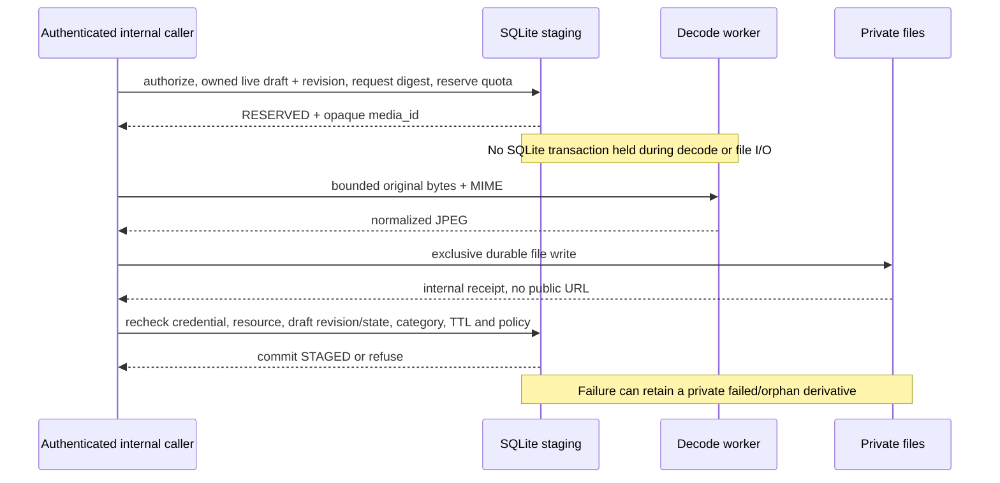

# M2b.3 — owner-authorized private media staging

Internal opt-in service; not HTTP/MCP registration, attachment or publication.
[Exact-SHA CI acceptance](ci-m2b3.md) covers this internal staging slice. No live
schema migration or new scope issuance is implied.

## Contract and boundaries

`MediaStageStore` reuses the persisted credential checks of `DraftStore` with
`listings:write` for staging/retry, `listings:read` for owner reads. Principal must
come from a real authenticating adapter, never a JSON user ID. Current enrollment
still issues rooms scopes only; synthetic CI fixtures seed listing scopes directly.

A derivative is linked to an existing owned, editable, live draft, exact revision,
credential audience/resource and fixed normalization policy. Category ancestry must
remain active. A private opaque UUID media_id is distinct from the private blob key;
responses never return a filesystem path or blob key. Guessed IDs do not authorize reads.

Initialization explicitly adds independent version3 `media_stage_schema` and
`media_stages` tables and positional `media_draft_photos` links to the existing snapshot database. It requires market schema2;
partial/future namespaces fail closed. Room schema/application_id/user_version are
unchanged. An explicit additive1/2→3 migration preserves cleanup phases and adds photo links; there is no automatic
request-triggered migration. [Retention contract](media-cleanup.md). Neither current server startup nor an HTTP request creates these tables.

## State machine / transaction boundaries

`RESERVED → STAGED` or `RESERVED → FAILED`. File durability precedes the STAGED
transaction; SQLite and the filesystem are not one ACID transaction. On ordinary
exceptions the service best-effort marks only its already-reserved upload FAILED,
retaining a known derivative key for later reconciliation. A crash may leave a
RESERVED row or private orphan. No best-effort destructive deletion of arbitrary
files is attempted by this service.

Every replay rechecks current persisted rights first. The request digest binds
original byte SHA-256/length, MIME, draft/revision, policy and audience. Same owner
+ client UUID with different data conflicts. Completed retry checks stored-byte
integrity, returns the same media_id/expiry and does not decode or write again.
Pending retry immediately returns `media_upload_pending`; no second worker is
started. Failed retry returns a stable failure and never silently retries work.
Expired reservations/results are unavailable and cannot extend their lifetime.

Reads authorize before opening the file and re-authorize after bounded integrity
I/O, checking the manifest is unchanged. Revocation, disability, audience mismatch,
scope loss, expiry, archive/revision/category changes fail closed. The final read
transaction is the authorization linearization point; no impossible guarantee is
made about a revocation occurring after that check and before network delivery.

## Candidate admission budgets

- Global128 rows /32MiB reserved derivative bytes.
- Per owner16 rows /16MiB reserved derivative bytes.
- Each operation reserves the maximum2MiB derivative budget before decoding.
- TTL10 minutes, capped by draft expiry, never extended on retry.

Expired/failed rows retain budget until explicit reviewed cleanup reaches PURGED
with durable file absence. Ordinary requests never auto-clean. Purged rows remain
idempotency tombstones, separately capped at512 globally /128 per owner lifetime.
This is not an unlimited rolling service: receipt compaction/scheduling remains a
separate gate. See [reviewed retention](media-cleanup.md).

Physical file count/bytes are separately checked by the file layer; per-owner DB
budgets do not replace root/disk/WAL budgets. HTTP streaming/admission/time limits,
OS filesystem/network sandbox and fleet concurrency remain separate gates.

## Explicit non-goals / next slice

The staging API itself does not attach photos. [PhotoDraftStore](photo-drafts.md)
now provides an explicit opt-in versioned attachment boundary; generic draft APIs
still reject client-supplied media IDs and photo-unaware updates. Attachment uses
its own revision/receipt and fixed draft-retention promotion, not staging replay.
Private intents are not live-publication consent.

Still required: attach/idempotency/revision and ordered media preview hashes;
explicit orphan recovery, receipt compaction/scheduling and DB+files recovery;
authenticated upload/read adapters and actual user scope issuance; explicit consent
and public projection; separate admin controls; operator-approved OS sandbox TEST.
No VPS, main, Caddy, real key or production service changed in this implementation.
