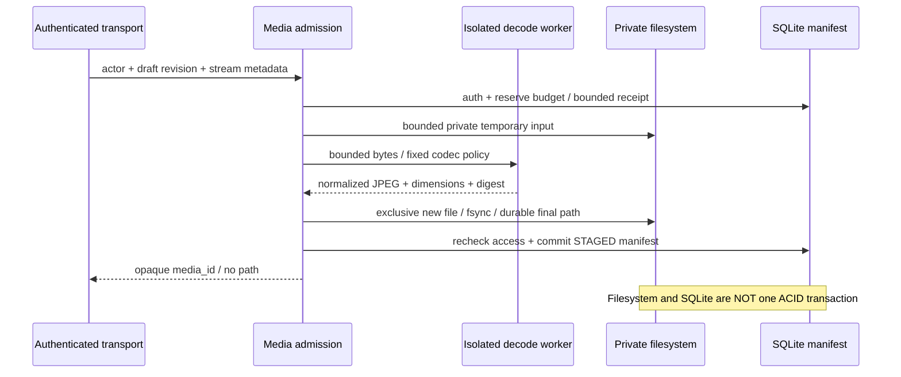

# M2b — проект изоляции и хранения фотографий

**SPEC, не реализация.** Дополняет проверенный [M2a normalizer](media-image-safety.md).
Ни один endpoint не должен принимать публичные фотографии только на основании этой схемы.
Цель следующего кодового среза — внутренний worker + private staged derivative на
синтетических fixtures в CI; не одновременный запуск upload/publish на VPS.

## Границы

1. Transport устанавливает общий streaming byte cap, лимит времени, размера заголовков,
   частоты, очереди и одновременных загрузок. Не сначала `read()` произвольного тела.
2. Проверенный principal/credential/resource/scope; операция только над своим draft
   в разрешённом состоянии. ID владельца не принимается из JSON/формы.
3. Admission резервирует ограниченный объём/slot и проверяет отдельный media budget.
   Не полагаться на SQLite page cap как на ограничение файловой системы или WAL.
4. Оригинал поступает в непубличный ограниченный временный буфер; не логировать его,
   не выдавать URL и не хранить навсегда «на всякий случай». После обработки удалить.
5. Нормализованный результат фиксируется через отдельный media manifest и становится
   виден только своему владельцу. Attach к draft и publish — самостоятельные проверки.

## Worker: отдельный обязательный gate

- Изолированный subprocess на один bounded task; без токенов, пользовательской среды,
  произвольных argv, shell, URL, сети, путей чтения/записи из запроса.
- Linux CPU/address-space/file-size/process/FD limits устанавливаются внутри выделенного
  worker до импорта декодера; не менять process-wide лимиты API-сервера и не использовать
  небезопасный `preexec_fn` в многопоточном родителе. Wall timeout и аварийное завершение
  контролирует родитель. Лимиты не задаёт клиент.
- Размер ответа ограничивается во время чтения pipe, а не после `communicate()` без cap.
  Ненулевой exit/timeout/битый framing/лишние bytes = отказ; никакой частичный manifest.
- Численные RAM/CPU/parallelism бюджеты утвердить по CI и отдельной проверке реального
  VPS. Не выдавать непроверенную оценку памяти за рабочую настройку.
- Process + rlimit — containment ресурсов, **не полноценная защита от уязвимости нативного
  декодера**. До публичного ввода нужен OS sandbox: отдельный непривилегированный
  пользователь/namespace, private temp, запрет сети, read-only root и минимальные права.
  Операторская конфигурация проверяется отдельно; не имитировать её unit-тестом.

## Manifest и физические файлы

Концептуальные поля: media_id, owner_id, draft_id, normalized_digest, dimensions,
content_type, byte_size, policy_version, state, created_at, expires_at. Внешний ответ
не содержит storage key, домашний путь или оригинальный filename. media_id случайный,
не content hash. Guess-resistant ID не заменяет проверку доступа.

Состояния: RESERVED → STAGED → ATTACHED; PUBLIC — разрешённая проекция активного
объявления, а не общий chmod файла. Terminal cleanup отделяется от logical deletion.
Уменьшенные/публичные копии имеют тот же доказанный manifest; произвольный blob не
становится фотографией объявления только после получения media_id.

Директории private, фиксированный storage root, O_EXCL/no-follow, запрет symlink/
hardlink/directory alias, права0700/0600, generated filename. Перемещение файла и
SQLite commit не атомарны вместе: сначала durable final bytes, затем rechecked
manifest commit. Краш до commit оставляет непубличную сироту для reconciliation;
missing/corrupt bytes после commit — fail-closed, без ответа200 с пустой картинкой.
Не переиспользовать файл другого владельца по одному совпадающему digest.

## Attach / preview / публикация

Attach проверяет владельца media и draft, scope/revocation/state/expiry/политику,
revision CAS и атомарность receipt. Повтор команды не создаёт новый файл и не продлевает
сроки. Проверенный manifest, состав и порядок фотографий входят в новую точную preview
revision. Изменение любого фото отменяет прежнее согласие. Старые intents с
media_ready=false не принимаются будущим publisher.

Public GET читает только allowlisted active projection и committed derivative;
непубличный draft/photo не становится доступным по прямой ссылке. Нужны безопасный
Content-Type, nosniff и cache/unpublish policy: невозможно обещать удаление уже
скачанной посторонним копии из интернета. Не помещать credentials в URL.

## Recovery / retention / тесты выхода

- Оба направления orphan/missing-file reconciliation; dry-run/report перед destructive
  maintenance. Никогда не обходить весь произвольный путь, заданный клиентом.
- TTL staged uploads, лимит количества/bytes/receipt reserve, удаление после archive/
  expiry по утверждённому горизонту и квоты для защитных действий. Физическая уборка
  не должна зависеть от нового публичного запроса или бесконечно копить receipts.
- Снимок SQLite согласован с manifest и выбранным набором bytes; проверка новой
  восстановленной копии, digest, сохранения отзыва credentials и сирот отдельно.
- CI: invalid/oversized input, timeout/kill/output cap, queue pressure, owner isolation,
  revoke during processing, attach retry/race, crash before/after file/DB commit,
  symlink/hardlink rejection, full disk/quota, expiry, integrity/reopen/recovery.
- Отдельный operator TEST подтверждает OS sandbox/память/права и не трогает старые
  MCP сервисы. До этого SOURCE/CI не означает готовность public upload или PROD.

## M2b.1 implementation boundary

[One-shot resource-limited worker](media-worker.md) is prepared as an internal
code slice. Its CI proof is separate from OS sandbox acceptance and storage
implementation. This overall storage document remains SPEC.

## M2b.2 implementation boundary

[Private filesystem primitives](media-private-files.md) prepare durable derivative
bytes and integrity reads only. Ownership, reservations/manifests, attach and
reconciliation remain SPEC. Never expose filesystem read by blob key to clients.

## M2b.3 implementation boundary

[Owner-authorized private staging](media-staging.md) adds opt-in SQLite reservations
and private STAGED manifests with before/after credential/draft checks. Attachment,
rolling retention/budget reclamation, reconciliation/recovery and public APIs remain
SPEC. Expired/failed rows do not silently release their reserved file budget.

## M2b.4 implementation boundary

[Reviewed retention](media-cleanup.md) prepares snapshot-bound dry run/application,
phase2 cleanup, durable absence before byte/active-row budget release and retained
idempotency tombstones. Unknown/orphan files block destructive apply; no silent
orphan deletion. Full restore, receipt compaction, admin/scheduling and public
upload/attachment remain separate gates.
