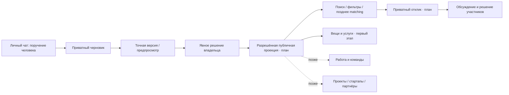

# Рынок возможностей из личного чата

## Продуктовое обещание и текущая граница

«Хочу — Предлагаю»: человек или его агент формулирует намерение и находит подходящих
людей и предложения. Web и MCP — два способа работы с одними объектами и правилами.
Не «продавать людей», не читать автоматически всю историю LLM и не заменять согласие
догадкой модели. Агент обязан отделять поручение пользователя от текста чужого объявления.

Сейчас: комнаты alpha; внутренние приватные черновики/предпросмотр/намерение публикации.
Публичная публикация, web-кабинет, поиск объявлений и отклики ещё не завершены.
Новые направления ниже — план, не существующие категории/поля/API.

| Направление | Примеры «хочу / предлагаю» | Особые правила будущего домена |
| --- | --- | --- |
| Вещи | Купить / продать / отдать / обменять | Состояние, реальные фото, цена/валюта, передача |
| Услуги | Найти мастера / предложить работу | Объём, срок, территория, согласование цены |
| Работа и специалисты | Найти работу / сотрудника / участника команды | Не публиковать резюме, контакты и чувствительные сведения автоматически; вакансии отдельно от услуг |
| Проекты и стартапы | Найти сооснователя / команду / пилотного клиента | Стадия, вклад, условия, защита непубличной информации |
| Инвесторы и партнёры | Найти знакомство / обсудить участие | Без обещаний доходности/проверенности, брокерских и платёжных функций; отдельная правовая оценка до запуска |
| Поездки и доставка | Найти поездку / предложить маршрут | Позднее: время, доступность, приватность геоданных и местные требования |

## Одна основа, отдельные контракты

Повторно используем identity, category references, draft/revision, media references,
модерацию, scopes, явную публикацию, приватный отклик и audit. Вид объявления задаёт
свою схему: резюме не товар с остатками, инвестиционный интерес не заказ такси.
Не создавать универсальную таблицу из сотен nullable полей и не копировать весь чат
в listing. Расширения вводить по реальному сценарию после общей работающей вертикали.

## Порядок развития

1. Одна настоящая вещь: корректные фото → черновик → согласие → публичная карточка → приватный отклик.
2. Подтвердить общий web/MCP путь на реальной услуге; проверить модерацию и администрирование.
3. По подтверждённому спросу выбрать ОДНУ следующую вертикаль и её критерии приёмки.
4. Только затем рекомендации/эмбеддинги, подписки на запросы, вакансии или партнёрский matching.

Бесплатный базовый сценарий, SQLite core, необязательные платные модели и отсутствие
географического барьера регистрации сохраняются. Возможная монетизация в будущем —
добровольные профессиональные инструменты и автоматизация, а не продажа личных чатов.
Спрос, конверсия и коммерческий успех пока не доказаны.
