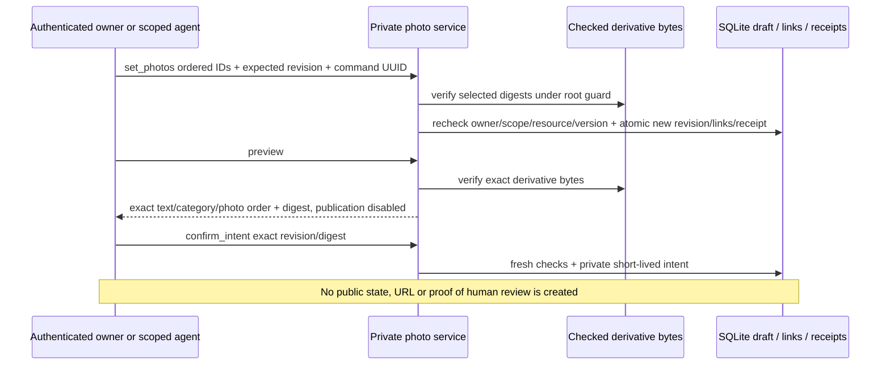

# M2c.1 — versioned private photos and exact preview

Internal opt-in service, not a public listing or publish endpoint. Exact-SHA CI
acceptance is recorded in [M2c.1 evidence](ci-m2c1.md). No VPS migration or scope issuance.

## One canonical private record

`PhotoDraftStore.set_photos` replaces an ordered list of0–8 unique opaque media IDs
for one owned editable draft, with expected revision + client UUID. The selected
list is stored atomically in both the draft content and constrained positional
links (`media_draft_photos`). Disagreement fails closed; no silent repair.

Selected derivatives must be STAGED, same owner/draft/audience, current source
revision, live cleanup phase, unexpired and current policy. The service verifies
stored bytes under the shared root guard before a short write transaction; rights,
category, draft revision and the exact manifests are rechecked before commit.
Checksums never run inside a SQLite write transaction.

The transaction increments the draft revision, replaces links, rebinds selected
manifest revisions and writes the command receipt together. Same command returns
its historical result without a new revision or retention extension. A receipt is
not proof of current state or permission to publish. Different payload/order under
the same UUID conflicts. Concurrent versioned changes cannot both win.

`update_content` changes text/category while preserving and rechecking the selected
photos. Input content cannot smuggle media IDs. The legacy text-only editor/preview
rejects photo-bearing records; old commands may still replay historical receipts,
but they do not change current data. Normal owner get/list show the canonical IDs.
Legacy archive remains private and prevents further photo reads/edits.

## Retention and budgets

An explicit attachment promotes a selected derivative's retention from the short
staging TTL to the **existing fixed draft deadline**, never beyond it. Retries do
not extend that deadline. Reordering/text edits do not prolong draft life.
Detaching a live derivative rebinds it to the new revision and caps retention to
10 minutes from removal (or its earlier existing deadline). A valid detached photo
may be reattached within that window; an expired/purged photo cannot be revived.

Removing a broken photo is allowed without serving/checksumming the removed bytes;
selected retained photos must always pass verification. Corrupt files are not
silently deleted: reviewed cleanup/orphan recovery retains its separate safeguards.

The candidate per-owner reservation budget is now16MiB so eight maximum2MiB
photos fit. Global derivative reservation remains32MiB, not a global-scale capacity
claim. The row/receipt/root caps and explicit cleanup still apply. No load testing
on the VPS is inferred from synthetic CI.

## Photo-aware private intent v2

New schema `mcp-rooms/private-photo-intent/v2` binds the canonical record, resource,
category path, ordered photo IDs/digests/dimensions/bytes/policy/deadlines and notice.
Responses contain no private blob key, filesystem path, credential or original bytes.
Text is untrusted data, not HTML. The future web renderer must escape it.

`private_photos_verified=true` means this private check only. `media_ready=false`
and `publication_enabled=false` remain explicit. A scoped agent may record an
intent, so this is not proof a human saw a UI. Confirmation needs listings:publish;
read requires listings:read; editing requires listings:write; persisted grants are
checked again after file I/O. No current enrollment issues these listing scopes.

Intent get revalidates current draft/category/ordered manifest/digests and TTL;
changing text, selected photos or order invalidates the previous intent. Replay
never refreshes consent or its deadline. v1 photo-unaware intents cannot be used to
publish photos, and v2 remains a **private** contract. A future live publisher needs
a new notice/schema, fresh explicit owner approval, transactional consume/state/audit
and public projection checks. Never silently upgrade this stored private intent.

## Explicit media migration to schema3

Initializer explicitly upgrades media1/2→3 in one SQLite transaction, preserving
legacy bytes/rows. Legacy1 first receives cleanup columns, then the positional
photo table. Schema3 adds only those links; it does not change the market namespace2
or RoomStore identifiers. Request handlers do not migrate. Future/partial namespace
is refused; no live migration was performed.

## Remaining gates

Actual live-publication transaction/projection, authenticated bounded upload and
scope issuance, human web/session/consent UI, private responses, separately authenticated
admin capabilities, full OS sandbox/recovery/load acceptance and approved deployment.
See [deployment milestones](deployment-readiness.md); this code slice alone is not a
usable public marketplace or an approval to touch main/VPS.
