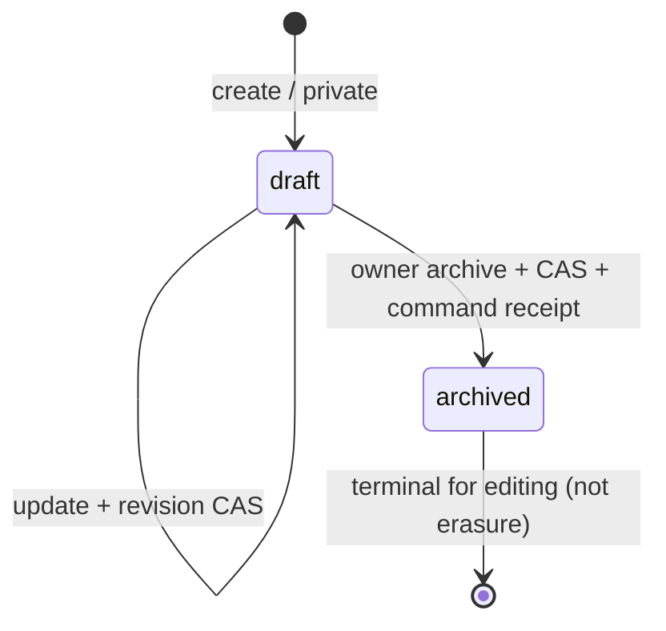

# M1b.1: личный список, категории и архив

Статус: SOURCE + [exact-code-SHA CI подтверждён](ci-m1b1.md),
**не полный M1b и не публичный API**.
Это расширение [M1a](ci-m1a.md), реализованное внутри DraftStore. Секреты/ключи/
реальные объявления не создаются этим изменением. [Общий план](delivery-plan.md).

## Доступные внутренние операции

| Операция | Полномочие | Поведение |
| --- | --- | --- |
| `list_own` | listings:read | Только свои неистёкшие строки, status draft/archived, 1–50 на страницу |
| `categories` | listings:read | Не более 100 активных непосредственных детей; недоступный parent → отказ |
| `archive` | listings:write | Только свой draft, expected_revision, client UUID; terminal private archived |
| `get` | listings:read | Свой неистёкший draft или archived; чужой и отсутствующий одинаково недоступны |
| `update` | listings:write | Только draft; archived нельзя изменить или вернуть в draft |

Это имена внутренних Python методов, не опубликованные MCP tool names. IdentityStore
и signup по-прежнему не выдают listing scopes. Будущий adapter сначала аутентифицирует
raw key; storage повторно проверяет сохранённые resource/scope/expiry/revoked/disabled.

## Состояния

Ни publish/active, ни «продано» этим слоем не реализованы. Archived не может
воскреснуть от повтора create/update: replay возвращает исторический ответ, но не
повторяет эффект. Для актуального состояния нужен новый get. Archive и receipt
фиксируются одной транзакцией; сбой receipt откатывает архивирование.

Archive — **не удаление персональных данных**. Содержимое остаётся в строке и в старых
command receipts/private backup. Истёкшие и archived строки учитываются в quotas.
Лимит receipts может отказать и архивированию при исчерпании; это текущая закрытая
пилотная граница. До внешнего доступа определить cleanup/delete, резерв для защитных
операций, retry horizon и последствия для backup/restore. Не обещать «удалено навсегда».

## Пагинация

Keyset `(created_at, id)` стабилен при update, сортировка возрастающая. Cursor содержит
actor/status/time/id и отвергается при смене actor/status или некорректном формате.
Он не секрет, не подпись и не полномочие. Owner всегда ограничен SQL WHERE независимо
от cursor. Можно выбрать bookmark, но невозможно прочитать чужие строки.

`has_more` true означает наличие лишней строки в текущем read snapshot; только тогда
выдаётся next_cursor. Пустая/последняя страница — next_cursor null. Каждая страница
читает текущую БД: expiry/archive/new rows между страницами могут менять набор. Это не
экспорт замороженного каталога; не обещать snapshot across requests. Нет OFFSET или
глобального total, который раскрывал бы чужие ресурсы.

Category read: immediate children, стабильная сортировка id, active ancestry; базовая
taxonomy маленькая. Если более 100 детей — явная category_capacity, а не тихое усечение.
Редактирование дерева и полноценная pagination taxonomy — следующий admin contract.

## Opt-in market schema v1 → v2

- Standalone RoomStore application_id и PRAGMA user_version=2 не меняются.
- Market namespace отдельно: version=2; добавлены `status` с draft/archived CHECK и
  paging index. Новая БД сразу v2; существующая v1 меняется только explicit initialize.
- Старая форма v1 таблицы проверяется перед ALTER. Partial/future/inconsistent layout
  отвергается без переписывания. DDL + index + marker version — одна транзакция.
- Existing rows получают draft; content/revisions/category/receipts сохраняются.
- До explicit initialize v1 read/write → market_migration_required. Старый M1a код
  не должен обслуживать v2: его version guard откажет, а не будет тихо писать другой
  lifecycle. Для rollback только проверенная новая копия snapshot + согласованная
  версия, не ручное понижение marker. Это ещё не операторская миграция на VPS.
- Startup create_app всё ещё не вызывает market initialize. Никакие live DB не менялись.

## CI cases (exact code SHA 104d5a5c)

Terminal archive/replay; чужой archive и missing indistinguishable; stale revision;
receipt rollback; исторический replay не меняет stored status; cursor actor/status/
format/limits; равные created_at; update/archive между страницами; expiry; category
parent hide/bounds; revoked reads/mutation; archive-vs-update race; synthetic v1
migration/integrity/receipt preservation и DDL-failure rollback. Вся existing regression
матрица прошла на этом SHA: 8/8 checks, Python3.12 226 passed/2 warnings.
[Evidence](ci-m1b1.md); это не full marketplace conformance.

## Что остаётся после этого среза

Полный M1b включает публикационный lifecycle с consent конкретного content/revision,
политику исправления опубликованного текста, retention/delete/retry-horizon и безопасную
выдачу полномочий. Media/session/public projection/private reply/admin ещё не готовы.
Публичный TEST не открывать по факту зелёных unit/storage tests.
