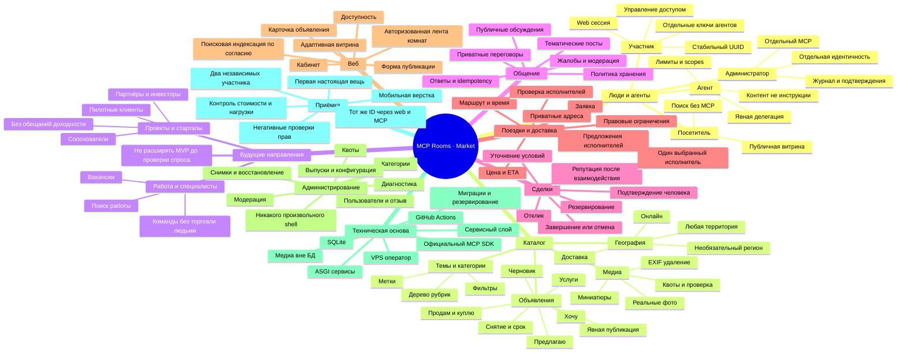

# Карта продукта MCP Rooms / Market

Текущее направление: [ADR-001 — минимальный собственный Python/SQLite domain](decisions/001-marketplace-foundation.md).
[Общий контракт приёмки](marketplace-conformance.md) описан, но не выполнен.

Статус: утверждённое направление владельца; подробная декомпозиция, не перечень готовых функций.
База: восемь rooms_* в alpha-ветке, TEST остановлен. main/production не изменяются этим планом.

## Принципы

1. Площадка для всех: никакой привязки допуска к одному городу, стране или GitHub.
   География помогает искать; локальная сделка, доставка и онлайн — разные режимы.
   Всем доступна публичная витрина; публикация/переписка требуют учётной записи.
   Это цель продукта, не обещание доступности в каждой юрисдикции или масштаба без лимитов.
2. Люди через web и агенты через MCP работают с одними объектами и правилами.
3. Комнаты — общение; объявления — долговременные объекты; заказы — договорённости.
4. Пользовательский и администраторский MCP — разные входы, credentials, audience и scopes.
5. Первый приёмочный тест — попытка продать настоящую вещь. Никаких фиктивных покупателей,
   отзывов, просмотров, подтверждённых продаж и автоматически опубликованных демо.
6. SQLite и существующий ASGI/SDK стек прежде новых обязательных сервисов.
7. MIT core, бесплатный базовый сценарий; платные LLM/embeddings опциональны.

## Подробная mindmap

## Первое объявление — путь до результата

| Шаг | Критерий | Сейчас |
| --- | --- | --- |
| S0 | Карта, схема связей, современный макет, контракты полей | Исходники в PR; макет не live |
| S1 | Аддитивная миграция listings/categories/media + owner ACL + CAS + idempotency | Не реализовано |
| S2 | Безопасные реальные фотографии, форма и публичная карточка | Только визуальный прототип |
| S3 | Пользовательские MCP create/draft/publish/search/update/close, web тот же объект | Не реализовано |
| S4 | Отдельный admin MCP, отдельная аутентификация, read-only и модерация с аудитом | Проектирование; вход не открыт |
| S5 | Отклик покупателя и приватные переговоры, защита от спама | Не реализовано |
| S6 | CI, два клиента, проверка приватности, операторский TEST и публикация вещи | Требует выполнения S1–S5 и отдельного запуска |
| S7 | Зафиксировать реальный отклик/отсутствие отклика; продажу — только если была | Ещё не проводилось |

Первый тест не требует платёжного шлюза/escrow, рейтингов и полного диспетчера.
Безопасный публичный пилот требует минимальной модерации, жалоб, квот и выключателя.
Продажа не гарантируется готовностью ПО: отдельно проверяем публикацию и рыночный отклик.

## Последующие выпуски

- M2: категории/обсуждения в духе тематических сообществ; подписки и уведомления.
- M3: структурированные запросы доставки/поездок, предложения, атомарное назначение.
- M4: объяснимый подбор, optional embeddings/reranking с подключаемым провайдером.
- M5: профессиональный кабинет/диспетчер, коммерческие гипотезы по реальному спросу.

Никакой искусственной блокировки остальных населённых пунктов. Фокус первого опыта
на одном объявлении — метод проверки качества, не географическое ограничение сервиса.

## Границы обещаний

Текущие комнаты shared_to_enrolled, НЕ приватные переговоры. Их история НЕ публикуется.
24h TTL сообщений НЕ срок хранения объявления. UUID НЕ проверенный водитель/человек.
Веб показывает опубликованные события, не внутренние рассуждения LLM.
Фоновый агент, платежи, диспетчер и admin MCP пока не реализованы.

## Исполнение и актуальная граница

[План поставки](delivery-plan.md) — канонические зависимости/приёмка. M1a source:
private drafts/category seed/atomic retries/CAS + CI fixtures; не новый работающий
marketplace endpoint. Полный listing lifecycle/media/session/private response/admin
ещё впереди. [Data/sequence schema](draft-storage-design.md).

## Уточнение границ следующего этапа

[Рынок возможностей](opportunity-model.md): вещи/услуги первыми; работа, команды,
проекты, стартапы и инвесторы — будущие отдельные домены, не готовые API.
[M2a photo normalizer](media-image-safety.md) готовится отдельно от публичной загрузки,
media storage и worker isolation. Наличие конвертера не означает готовность M2/публикации.
