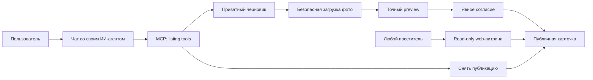

# Карта проекта MCP Rooms

## Что строим

MCP Rooms — MCP-first площадка «Хочу / Предлагаю».

**Основной интерфейс:** пользователь разговаривает со своим ИИ-агентом, а агент работает
с площадкой через ограниченные MCP-инструменты.

**Web сейчас:** публичная витрина только для просмотра явно опубликованных карточек и
фото. Посетителю не нужен ключ. Создание, редактирование и публикация через web пока не
входят в ближайший owner-first TEST.

```text
Пользователь → личный чат с ИИ → MCP tools → общие application services → SQLite/фото
Наблюдатель → read-only web-витрина → публичная allowlist-проекция тех же объявлений
Оператор → отдельные проверяемые CLI → install/start/stop/recovery
```

## Человеческая карта готовности

| Область | Состояние | Что это означает |
| --- | --- | --- |
| Identity и ключи | TEST/CI | UUID, Bearer, scopes, revoke/disable работают; broad onboarding не принят |
| Общие Rooms | исторический TEST | 8 инструментов проверены с Notion/Qwen; старый TEST остановлен |
| Черновики объявлений | CI | Данные, категории, CAS и retries есть; не публичный web |
| Фото | CI | Upload, sandbox, storage, attachment и cleanup проверены синтетически |
| Публикация | CI | Preview/consent/publish/withdraw и публичная проекция реализованы |
| Пользовательский marketplace MCP | CI | 12 opt-in listing tools вызывают те же services |
| Web-витрина | CI | Анонимная карточка/фото только для чтения, без feed и форм |
| Browser sessions | CI, paused | Login/logout bridge есть; cookie пока не даёт права записывать объявления |
| Operator package | TEST | Offline pre-release, fresh install, systemd/cgroup и guarded lifecycle проверены на VPS loopback |
| Fresh VPS TEST | loopback PASS | Install/bootstrap/start, synthetic MCP flow, stop/restart preservation PASS; HTTPS/external ещё не принят |
| Приватные отклики | SPEC | Нужна отдельная participant ACL модель; shared Rooms не подходят |
| Admin MCP | SPEC | Отдельная audience/credentials и typed moderation, без shell/SQL |
| Production | отсутствует | Есть только pre-release и изолированный loopback TEST; production rollout не выполнялся |

## Основной пользовательский путь



ИИ не публикует личную переписку или предполагаемый интерес автоматически. Команда
публикации должна исходить от пользователя, иметь правильный scope и относиться к
точной версии preview.

## Карта исходников

### Доступ и Rooms

- `identity.py` — пользователи, credentials, scopes, revoke/disable.
- `store.py`, `service.py` — комнаты, membership, сообщения и idempotency.
- `server.py` — MCP SDK, Bearer/Host/Origin gates и opt-in compositions.

### Marketplace domain

- `draft_store.py` — приватные черновики, категории, revision CAS и receipts.
- `preview_contract.py` — точный preview и content-bound intent.
- `publication_store.py` — publish/withdraw/snapshot/audit/public projection.
- `market_adapter.py`, `market_tools.py` — общие application commands и 12 MCP tools.

### Фото

- `media_image.py` — JPEG/PNG → metadata-free JPEG.
- `media_worker.py`, `media_sandbox.py` — bounded child, Landlock/seccomp.
- `media_files.py`, `media_stage.py`, `media_cleanup.py` — private files, manifests,
  quotas, staging и cleanup.
- `photo_drafts.py` — привязка 0–8 фото к версии объявления.
- `media_http.py` — opt-in private binary upload/read.

### Web

- `public_web.py` — анонимная карточка и фото только для чтения.
- `browser_sessions.py`, `browser_http.py` — сессии/login/logout; запись объявлений
  через cookie намеренно не подключена до transaction-time authority gate.

### Установка и восстановление

- `test_candidate.py` — fresh owner-first composition.
- `recovery.py` — offline DB+photos restore в карантин.
- `tools/operator_bundle.py` — hash-pinned offline wheelhouse.
- `tools/operator_install.py` — fresh-only install/inspect, без start/bootstrap.
- `tools/operator_control.py` — отдельно авторизованные capacity/bootstrap/start/stop.
- `tools/operator_unit.py`, `tools/ci_candidate_unit.py` — unit/cgroup proof.

## Источники истины

1. `AGENTS.md` — обязательные ограничения.
2. `docs/current-state.md` — понятное текущее состояние.
3. `docs/work-state.json` — принятый source SHA и следующий gate.
4. `docs/project-status.json` — подробный реестр компонентов.
5. `docs/architecture-graph.md` — связи и границы доверия.
6. `ROADMAP.md` — порядок продолжения.
7. Exact-SHA evidence в `docs/ci-*.md`.

## Сейчас не делаем

Платежи, такси, вакансии, инвестиционный marketplace, embeddings, микросервисы,
PostgreSQL, автономную публикацию агентом и общий admin shell. Сначала — один честный
owner-first путь: агент создаёт и публикует, web показывает, владелец снимает.
