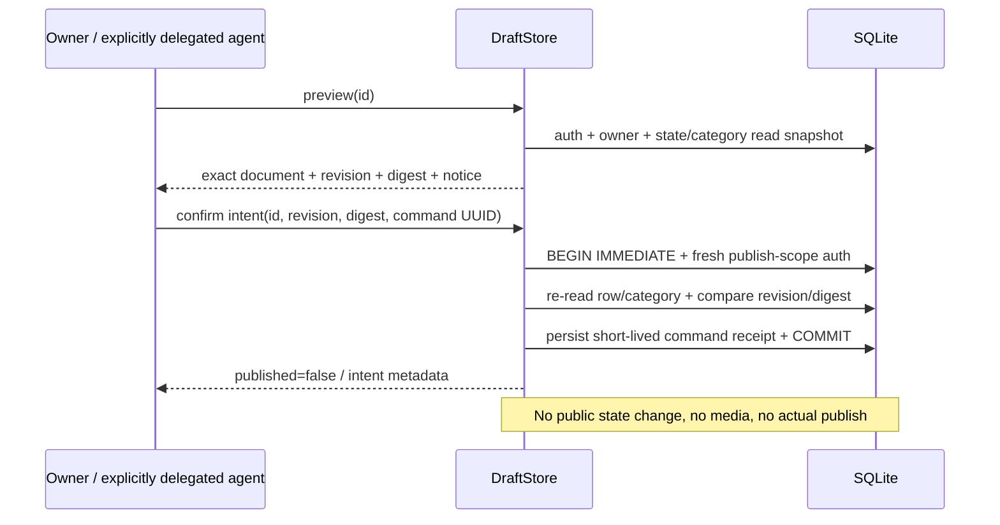

# M1b.2: точный предпросмотр и приватное намерение публикации

Статус: SOURCE + [CI на code SHA 2108b93e](ci-m1b2.md): 8/8 checks,
Python3.12 247 passed/2 warnings. **Не публикация и не полный M1b.**
Код: `preview_contract.py`, внутренние методы `DraftStore.preview`,
`confirm_publication_intent`, `get_publication_intent`. Эти методы не зарегистрированы
в user MCP/HTTP; listing scope issuance в текущей IdentityStore не включена.

## Что связывается с подтверждением

Canonical preview содержит schema/policy notice, resource, точную Listing запись
(ID/owner/content/status/revision/timestamps), конкретную категорию и весь breadcrumb.
Digest SHA256 считается над deterministic JSON с domain separation. Цена/валюта,
описание, режим передачи, локация, категория и версия не остаются за пределами preview.
Это JSON для будущего безопасного рендера, не HTML и не публичная проекция. Текст
остаётся untrusted; шаблон обязан escaping. Digest не секрет и **не аутентификация**.

`preview` требует listings:read и owner доступа к неистёкшему draft. Confirm требует
**listings:publish** в trusted Principal и persisted credential scopes. Наличие
rooms:write/listings:write не даёт этой власти. Scope в fixtures синтетический;
обычный signup или IdentityStore пока его не выдаёт.

## Срок, повторы и актуальность

Receipt хранит resource, listing ID/revision, preview digest, recorded_at, valid_until,
intent_id и published=false. Срок — максимум 5 минут, не дальше expiry draft.
Один actor/client UUID/operation/payload повторяет исторический результат без новой
записи и без продления срока. Иной payload/операция — conflict. Нет нового schema
upgrade: используется уже существующая private market_commands таблица.

Исторический replay **не подтверждает актуальность**. `get_publication_intent` отдельно
проверяет сейчас key/resource/scope, owner, draft state, revision, category manifest,
policy digest и deadline. Update, archive, смена видимой категории/resource, expiry
либо revoke делают прежнее намерение непригодным. Старые receipts остаются private
историей с прежней retention policy; это не бессрочное согласие и не физическое удаление.

Confirm не изменяет revision: он не редактирует содержание и не публикует. Изменение
содержания после confirm всегда требует нового preview/intent. Category title/path
меняется вне Listing revision, поэтому также включён в digest.

## Важные ограничения безопасности

- Scope у агента означает делегированное полномочие, а не доказательство, что человек
  лично просмотрел экран. Здесь нет CAPTCHA/MFA/human-review attestation. До первого
  настоящего объявления агент должен получить явное согласие владельца на показанный
  текст/фото/условия. Не заявлять «криптографически доказано участие человека».
- Нынешний notice говорит, что публикация выключена, media_ready=false. Старый intent
  нельзя использовать для будущей живой публикации. Для M2 нужен новый schema/notice,
  verified media manifest с digest, понятные публичность/контакты/условия и новый preview.
- `get_publication_intent` — read, **не разрешение другому процессу публиковать позже**.
  Будущий publisher обязан recheck+consume+state transition/audit в одной своей
  транзакции. Иначе возникает TOCTOU. One-time consumption сейчас не реализовано.
- Нет внешнего bearer/consent token, подписания или передачи секретов в URL. Intent ID
  непривилегирован и не даёт доступа без свежей аутентификации/scopes/owner.
- Ошибки не должны приводить к публикации. В этом срезе public state вообще отсутствует.

## Проверки

Exact canonical digest; full record/category binding; stale revision/wrong hash deny;
отдельный publish scope (persisted и snapshot); owner privacy; archive/update invalidation;
resource mismatch; deadline/clock rollback; повтор не продлевает срок; revoked replay;
receipt rollback и duplicate concurrency. Это internal tests, не доказательство готового
UI, HTTP/MCP, media, production или юридической силы согласия.

После CI продолжить media/публикационный контракт и retention/delete/quota reserve,
не открывать public endpoint на основании одного digest и зелёных unit tests.
