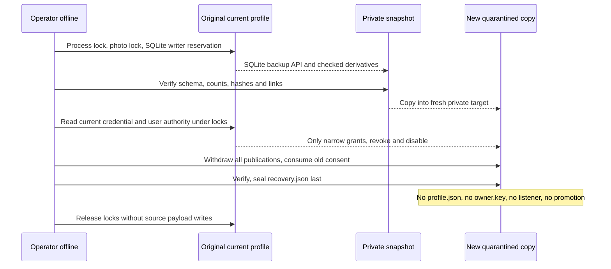

# F3b — офлайн-снимок DB+photos и карантин восстановления

**[Exact-SHA CI принят](ci-f3b.md):761 tests на3.12.** Не VPS execution и не production DR.
[TEST candidate](test-candidate.md), [принятая child policy](ci-f3a.md).

## Состав и граница

Отдельная операторская библиотека/CLI `mcp-rooms-recovery`, не MCP tool, HTTP route
или permission grant. Действия: snapshot, restore, verify. Все пути — только
доверенный ввод локального оператора; никогда не поля пользовательского запроса.
Никаких shell/SQL команд, расписаний, off-host transfer или auto-delete.

Snapshot и restore создают только **новую** owner-only директорию. Старый/частичный
путь не перезаписывается и не чинится. Нельзя вкладывать source/backup/target друг
в друга. Symlink/hardlink/shared/nonregular files отвергаются.

Snapshot удерживает process flock остановленного candidate → photo-root flock →
пустой SQLite BEGIN IMMEDIATE. Это исключает cooperating app и SQLite writers
до окончания копирования, а SQLite backup API читает committed WAL view отдельным
read-only connection. Не копируется только main DB живого сервиса. Writer reservation
откатывается без записи. Снимок включает DB, все bounded derivatives, в том числе
безопасные orphan files, и manifest counts/digests/schema/resource/origin.

Максимум256 derivatives/32MiB, каждый≤2MiB; DB≤64MiB, manifest≤128KiB. Есть
backup deadline15s; полный OS/disk/load budget остаётся F3c. Оригиналы фото,
owner.key, env, произвольные файлы и private logs не копируются. **В самой БД есть
чувствительные данные и credential digests**:0600 backup не означает encrypted или
безопасный для загрузки в публичный artifact.

## Проверка согласованности

Exact candidate schemas/SQLite integrity/FK, counts всех namespace tables, file
size/hash, ordered photo links, ownership/revision/resource, active publication
source hash и canonical projection. Полные derivative bytes сверяются, не
декодируются заново. Reserved upload/purging или повреждённая ссылка дают отказ,
не фиктивный successful backup. Orphans сохраняются, не удаляются автоматически.
Recovery manifest создаётся последним и fsync; ошибки/прерывание оставляют private
частичный путь **без ready marker**. Повторное использование запрещено.
Sealed snapshot не должен зависеть от непустого unhashed WAL.

## Restore и актуальные права

Текущий **оригинальный профиль обязателен** как authoritative security state,
под process/file/SQLite locks. Resource/schema и device+inode исходной директории
сверяются с snapshot origin. Другой профиль или недоступный current — отказ.
Это поддерживает проверяемую rehearsal-копию на том же хосте, **не** восстановление
после потери всего диска без свежего независимого security ledger. Не импортировать
JSON списка якобы действительных пользователей от клиента.

В новой копии права могут только сужаться:

- Snapshot revoked/disabled остаются таковыми; current revoke/disable/missing user
  и missing/mismatched credential отсекаются.
- Credential привязан к тем же user/digest/resource; scopes — пересечение, expiry —
  минимум. Пустое пересечение отзывает ключ. Новые replacement keys не переносятся
  в старый snapshot и не выдаются инструментом. Независимый допустимый пользователь
  не блокируется из-за отзыва чужого ключа.
- **Все** восстановленные публикации withdrawn, не только старые withdrawn: иначе
  старый snapshot мог бы воскресить снятое объявление. Consent marked consumed.
  Это операторское recovery policy, не поддельное действие/согласие пользователя.

## Карантин — намеренная граница, не deployment

Готовый snapshot/restored содержит `recovery.json`, **не `profile.json`**, не
owner.key. Candidate check/compose отвергает такую директорию. Restore не открывает
порт, не меняет origin DB/files и не вызывает compose. Проверки авторизации новой
копии выполняются внутренними сервисами в CI, а не доступным web/MCP сервером.

Состояние current верно на момент reconciliation, не навсегда после снятия lock.
**Не переименовывать recovery.json в profile.json** и не копировать profile marker.
Promotion/cutover требует отдельного согласованного security checkpoint, свежих
consent и reviewed rollback. В этой версии promotion API намеренно отсутствует;
следующий операторский пакет обязан сохранить карантин, а не молча запустить копию.
Same-UID/root hostile modification, authenticating/encrypted/off-host backups и
полный disaster recovery при утрате current не объявляются решёнными. Manifest
checksums — integrity, не signature или внешняя anti-rollback authority.

## Продолжение и тесты

`tests/test_candidate_recovery.py`: synthetic active/withdrawn publications, attached/
private photos, counts/bytes/integrity; revoke/disable/scope/expiry/digest/resource/
missing identity, independent principal, locks, aliases/corruption/incomplete states,
interruptions/no retry, no keys/stdout and no publication revival. Installed-wheel
smoke использует настоящий native JPEG из предыдущего upload. Все исполнения только
Actions; backup DB/photos не попадают в CI distribution artifact.

F3c остаётся dependency-pinned operator package, capacity/disk/retention/stop/rollback
и отдельные owner-approved preflight/loopback/HTTPS. Каждое удалённое исполнение
требует отдельного разрешения и специального пароля. Default rooms-only CLI, main,
production, signup и browser writes не меняются.

## Последовательность доверия

Эта схема — accepted offline rehearsal, не схема автоматической работы VPS.
